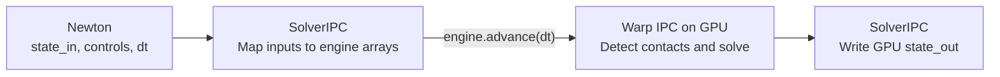
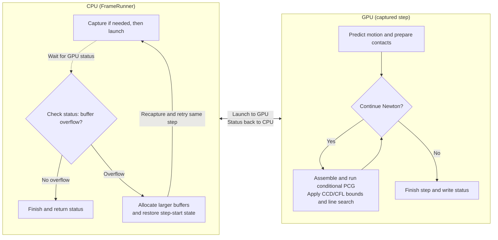

# libuipc-warp IPC Features

## About libuipc-warp

libuipc-warp is a rewrite of libuipc's Incremental Potential Contact (IPC) solver in NVIDIA Warp. It simulates frictional contact between deformable and affine bodies and keeps the main solve on the GPU to reduce CPU-GPU synchronization. It provides a pyuipc-compatible backend and a standalone Warp-array API.

## Feature list

- **Simulation models**
  - Tetrahedral soft bodies with Stable Neo-Hookean elasticity
  - Baraff-Witkin membranes and thin shells
  - Elastic and plastic shell bending
  - Rods, springs, and particles
  - Affine bodies (ABD)

- **Contact and collision**
  - Barrier-based IPC and augmented-Lagrangian IPC (AL-IPC)
  - Friction, self-contact, and continuous collision detection (CCD)
  - Contact thickness and per-material-pair settings
  - Mixed deformable and affine-body contact
  - Static triangle meshes and half planes

- **Constraints and control**
  - Soft position and transform constraints
  - Point-to-point, point-to-edge, and point-to-triangle stitching
  - External forces
  - Revolute, prismatic, fixed, and spherical joints
  - Drives, limits, and loads for revolute and prismatic joints

- **Solvers**
  - Implicit BDF1 and BDF2 time integration
  - Newton iterations with line search
  - PCG with block-diagonal or multilevel additive Schwarz (MAS) preconditioning

- **Interfaces and diagnostics**
  - Optional backend for existing pyuipc scenes. Pass `uipc_warp.frontend.Engine()` to the pyuipc `World`.
  - Standalone Warp-array integration through `ArrayScene` and `SimEngine`. No pyuipc installation required.
  - A subset of backend models available through the array scene builder
  - Frame statistics, stage timers, and debug dumps

## Newton integration

Newton owns the model, simulation state, and step schedule. At setup, `SolverIPC` converts the model geometry, materials, and collision filters to `ArrayScene` and creates the Warp IPC engine.

- The next Newton step can read `state_out` directly on the GPU.
- During capture, Python calls `SolverIPC.step()` to record this data path and the solve in Newton's graph. Replay runs the recorded GPU work without another Python call to `SolverIPC.step()`.
- Newton can optionally call `check_status()` after replay to read status flags. See [Whole-step CUDA Graph](#whole-step-cuda-graph) for the device loops and buffer overflow handling.

## Highlights

### Whole-step CUDA Graph

- **One launch for the full solve.** The captured step includes motion prediction, collision detection, contact and material assembly, the linear solve, line search, and state updates. `FrameRunner` replays the graph with one launch per attempt.
- **GPU-driven decisions.** Device kernels compute convergence tests and line-search acceptance. Their flags drive `wp.capture_while` for Newton, PCG, and backtracking, and `wp.capture_if` for branches such as re-running collision detection. The same graph can take different paths on different steps.
- **Fewer CPU-GPU round trips.** The CPU reads a small status record after the step. The GPU can advance or exit each loop without returning its residuals, counts, or trial results to the CPU between iterations.
- **Recovery when contact counts grow.** Preallocated buffers keep their addresses across replays. If a contact list exceeds its capacity, the GPU sets an overflow flag. `FrameRunner` then grows the buffers, restores the step-start state, and recaptures and retries the same step.
- **Caller-owned graphs.** Array callers can include the full step alongside their own kernels in an outer CUDA Graph and handle step status themselves.

[Engine architecture](../Newton-IPC/.cache/src/libuipc-warp/docs/architecture.md) | [Array API](../Newton-IPC/.cache/src/libuipc-warp/docs/array-api.md)
